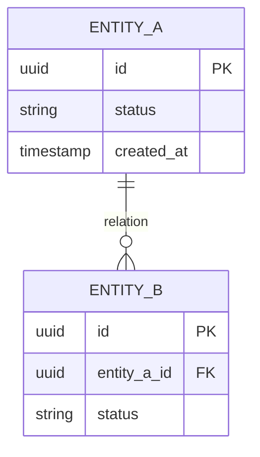
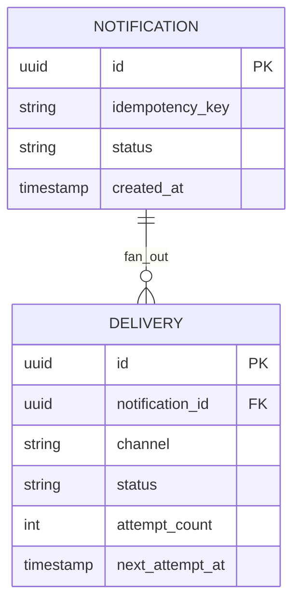

Prompt:

Write a technical specification for my project.

Project: A microservice for multi-channel notifications (Email, Telegram, Discord).

Specification standard:

# {{Service Name}} - Spec

**Date:** YYYY-MM-DD | **Status:** Draft | In Review | Approved
**ADRs:** [ADR-001](../docs/adr/0001-xxx.md), [ADR-002](../docs/adr/0002-xxx.md)

## 1. What & Why

**What:** [1-2 sentences: what the system does.]
**Why:** [1 sentence: the problem it solves.]

## Out of scope

## 2. Acceptance Criteria

**Functional**
- [ ] **AC-1:** [Given / when / then, with status code or state]
- [ ] **AC-2:** [...]
- [ ] **AC-3:** [...]

**Non-functional**
- [ ] **NFR-1 (Reliability):** [retry count, backoff, what happens after the last failure]
- [ ] **NFR-2 (Performance):** [p95 latency at N rps, external call timeout]
- [ ] **NFR-3 (Security):** [auth method, secrets never in logs/responses]

**Verification:** each AC is checked by [test name / `make` target].

## 3. Architecture

| Module | Responsibility | Allowed deps | Why this boundary |
|--------|----------------|--------------|-------------------|
| `api` | [...] | `core`, `shared` | [1 short reason] |
| `core` | [...] | `shared` | [...] |
| `queue` | [...] | `core`, `shared` | [...] |
| `adapters` | [...] | `core` (ports), `shared` | [...] |
| `shared` | [...] | none | [...] |

**Interaction:** [1-2 sentences: who calls whom; dependencies point inward to `core`.]
**Forbidden:** [key rules, e.g. `api` never imports `adapters`; adapters never import each other.]
**Enforced by:** [linter rule / import-check script / `make check-deps`].

**API surface** (full payloads in `docs/api.md`)
| Endpoint | Purpose | Key codes |
|----------|---------|-----------|
| `METHOD /api/v1/...` | [...] | 2xx, 4xx, 503 |

## 4. Data & Relations

**Status transitions:** `A -> B -> C`; `B -> FAILED`. Forbidden: [e.g. `SENT -> *`].
**Key constraints:** [unique keys, FKs, partial indexes that the design depends on.]

## 5. Data Update Scenarios

1. **Happy path:** [table.field: old → new, per step]
2. **Failure / retry:** [what changes, which counter increments, terminal state]
3. **Infra failure / edge case:** [behavior when queue/DB is down or worker crashes]

## 6. Risks & Decisions

| Risk | Impact | Mitigation | ADR |
|------|--------|------------|-----|
| [...] | High / Med / Low | [1 line] | [ADR-00X](...) |

## 7. Audit

Results: [`audit.md`](../audit.md). Every divergence is fixed by changing this spec, an AC, or a standard, not by a manual patch.

> AI output:

# NotifyPulse - Spec

**Date:** 2026-11-21 | **Status:** Draft
**ADRs:** [ADR-001](../docs/adr/0001-outbox-worker-architecture.md), [ADR-002](../docs/adr/0002-channel-adapter-ports.md)

## 1. What & Why

**What:** NotifyPulse is an asynchronous microservice that accepts notification requests and delivers messages across Email, Telegram, and 
Discord channels with per-channel tracking and retries.
**Why:** It decouples upstream services from slow or rate-limited third-party messaging APIs while preventing duplicate or dropped deliveries.

## Out of scope

* User preference management, opt-out lists, and template visual editors.
* Inbound webhook ingestion, two-way chat replies, or SMS/push channels.

## 3. Acceptance Criteria

**Functional**
- [ ] **AC-1:** Given a valid request targeting Email and Telegram with an `Idempotency-Key`, when `POST /api/v1/notifications` is called, then the service persists a `PENDING` notification and `QUEUED` channel deliveries and returns `202 Accepted` with the notification ID.
- [ ] **AC-2:** Given a duplicate `POST /api/v1/notifications` with the same `Idempotency-Key` and identical payload, when processed, then it returns `202 Accepted` with the existing notification ID without creating duplicate deliveries.
- [ ] **AC-3:** Given a queued delivery, when a worker dispatches to the channel adapter and receives `2xx`/provider acceptance, then that delivery transitions to `SENT` and the parent notification updates its aggregate status.

**Non-functional**
- [ ] **NFR-1 (Reliability):** Retry failed deliveries up to 5 times with exponential backoff plus jitter (`1s` to `60s`); after the 5th failure, mark the delivery `DEAD` and emit a dead-letter record.
- [ ] **NFR-2 (Performance):** Achieve `p95` ingestion latency under `120 ms` at `500 rps` sustained load, with a `5s` per-request timeout on external Email, Telegram, and Discord API calls.
- [ ] **NFR-3 (Security):** Authenticate callers via scoped service bearer tokens/HMAC signatures; redact bot tokens, SMTP credentials, and webhook URLs from logs and API responses.

**Verification:** Each AC is checked by `make test-unit`, `make test-integration`, and `make test-load`.

## 4. Architecture

| Module | Responsibility | Allowed deps | Why this boundary |
|--------|----------------|--------------|-------------------|
| `api` | HTTP handlers, auth, validation, idempotency | `core`, `shared` | Isolates transport concerns from domain logic |
| `core` | Notification lifecycle, routing, retry policy, ports | `shared` | Keeps business rules independent of I/O |
| `queue` | Job enqueueing, leasing, backoff scheduling | `core`, `shared` | Decouples delivery execution from API traffic |
| `adapters` | Email, Telegram, and Discord API clients | `core` (ports), `shared` | Swaps third-party SDKs without touching `core` |
| `shared` | Config, structured logger, error types, clock | none | Prevents circular imports across modules |

**Interaction:** `api` validates requests and delegates to `core`, which persists state and enqueues jobs via `queue`; 
background workers pull jobs and call `adapters` through port interfaces defined in `core`.
**Forbidden:** `api` never imports `adapters`; `adapters` never import each other or `queue`; `core` never imports external SDKs.
**Enforced by:** `make check-deps` (AST import boundary linter in CI).

**API surface** (full payloads in `docs/api.md`)
| Endpoint | Purpose | Key codes |
|----------|---------|-----------|
| `POST /api/v1/notifications` | Submit a multi-channel notification | `202`, `400`, `401`, `409`, `503` |
| `GET /api/v1/notifications/{id}` | Fetch notification and per-channel status | `200`, `401`, `404`, `503` |
| `GET /health` | Liveness and readiness check | `200`, `503` |

## 5. Data & Relations

**Status transitions:** `PENDING -> PROCESSING -> SENT | PARTIAL_FAILED | FAILED`; delivery `QUEUED -> SENDING -> SENT | RETRYING -> DEAD`. Forbidden: `SENT -> RETRYING`, `DEAD -> SENT`.
**Key constraints:** Unique index on `NOTIFICATION.idempotency_key`; FK `DELIVERY.notification_id -> NOTIFICATION.id`; partial index on `DELIVERY(next_attempt_at)` where `status IN ('QUEUED', 'RETRYING')`.

## 6. Data Update Scenarios
1. **Happy path:** `POST` sets `NOTIFICATION.status: null -> PENDING` and creates `DELIVERY` rows with `DELIVERY.status: null -> QUEUED`; worker sets `NOTIFICATION.status: PENDING -> PROCESSING` and `DELIVERY.status: QUEUED -> SENDING`; on adapter success, sets `DELIVERY.status: SENDING -> SENT` and `NOTIFICATION.status: PROCESSING -> SENT`.
2. **Failure / retry:** On `429`/`5xx`/timeout, worker increments `DELIVERY.attempt_count: n -> n+1`, sets `DELIVERY.next_attempt_at: now -> now+backoff`, and sets `DELIVERY.status: SENDING -> RETRYING`; on attempt 5 failure, sets `DELIVERY.status: RETRYING -> DEAD` and `NOTIFICATION.status: PROCESSING -> FAILED` (or `PARTIAL_FAILED` if another channel succeeded).
3. **Infra failure / edge case:** If DB or queue is unavailable on `POST`, return `503` without partial writes; if a worker crashes mid-dispatch while `DELIVERY.status = SENDING`, lease expiry returns `DELIVERY.status: SENDING -> RETRYING` so another worker retries safely.

## 7. Risks & Decisions

| Risk | Impact | Mitigation | ADR |
|------|--------|------------|-----|
| Channel rate limits (`429`) delay urgent alerts | High | Per-channel concurrency caps, `Retry-After` respect, and jittered backoff | [ADR-001](../docs/adr/0001-outbox-worker-architecture.md) |
| Duplicate deliveries during network retries | Med | Enforce `idempotency_key` uniqueness and provider message IDs | [ADR-001](../docs/adr/0001-outbox-worker-architecture.md) |
| Provider payload/formatting drift in Telegram/Discord | Med | Isolate formatting and error mapping inside channel adapters | [ADR-002](../docs/adr/0002-channel-adapter-ports.md) |

## 8. Audit

Results: [`audit.md`](../audit.md). Every divergence is fixed by changing this spec, an AC, or a standard, not by a manual patch.

> За основу було взято чернетку від AI, після чого я вніс такі зміни:

1. Форматування: оновив нумерацію та назву.
2. API: додав опис request payload.
3. NFR-3: уточнив спосіб автентифікації - bearer token.
4. ER-діаграма: додав у таблицю DELIVERY поля last_error, provider_message_id та request (JSON).
5. Вимоги: додав критерії приймання (AC) для обробки помилок.
6. Архітектура: замість черги на PostgreSQL вирішив використати BullMQ + Valkey.
