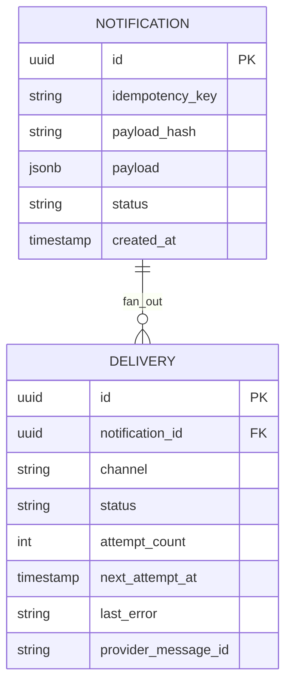

# Notification gateway

**Date:** 2026-11-21 | **Status:** Draft  
**ADRs:** [ADR-001](../docs/adr/001-async-queue-bullmq.md), [ADR-002](../docs/adr/002-duplicate-deliveries.md), [ADR-003](../docs/adr/003-channel-adapter-ports.md)
## 1. What & Why

**What:** Asynchronous microservice that accepts notification requests and delivers them via Email, Telegram, and Discord with per-channel tracking and retries.  
**Why:** Decouples upstream services from slow or rate-limited messaging APIs while preventing duplicate or dropped deliveries.

## 2. Out of scope

- User preference management, opt-out lists, template visual editors.
- Inbound webhooks, two-way chat replies, SMS/push channels.

## 3. Acceptance Criteria

**Functional**

- [ ] **AC-1:** Given a valid request for two or more channels with an `Idempotency-Key`, when `POST /api/v1/notifications` is called, then the service persists a `PENDING` notification and `QUEUED` deliveries and returns `202` with the notification ID.
- [ ] **AC-2:** Given the same `Idempotency-Key` and identical payload (same `payload_hash`), then it returns `202` with the existing ID and creates no new deliveries; with a different payload it returns `409`.
- [ ] **AC-3:** Given a queued delivery, when the adapter returns `2xx`/provider acceptance, then the delivery becomes `SENT`, `provider_message_id` is stored, and the notification's aggregate status is updated.
- [ ] **AC-4:** Given an invalid request to `POST /api/v1/notifications`, then the service returns:
  - `401` for a missing or invalid credential;
  - `400` for an invalid payload;
  - `503` if the DB or queue is unavailable.

**Non-functional**

- [ ] **NFR-1 (Reliability):** Retry up to 5 attempts total with exponential backoff plus jitter (`1s`-`60s`); after the 5th failure mark the delivery `DEAD`, store `last_error`, and emit a dead-letter record.
- [ ] **NFR-2 (Performance):** `p95` ingestion latency under `120 ms` at `500 rps` sustained; `5s` timeout on external API calls.
- [ ] **NFR-3 (Security):** Scoped service bearers auth; redact bot tokens, SMTP credentials, and webhook URLs from logs and responses.

**Verification:** `make test-unit`, `make test-integration`, `make test-load`.

## 4. Architecture

| Module | Responsibility | Allowed deps | Why this boundary |
|--------|----------------|--------------|-------------------|
| `api` | HTTP handlers, auth, validation, idempotency | `core`, `shared` | Isolates transport from domain logic |
| `core` | Lifecycle, routing, retry policy, ports | `shared` | Business rules independent of I/O |
| `queue` | BullMQ + Valkey job enqueueing, lock management, backoff retries | `core`, `shared` | Decouples delivery from API traffic |
| `adapters` | Email, Telegram, Discord clients | `core` (ports), `shared` | Swap SDKs without touching `core` |
| `shared` | Config, logger, errors, clock | none | Prevents circular imports |

**Interaction:** `api` validates and delegates to `core`, which persists state and enqueues jobs via `queue`; workers pull jobs and call `adapters` through ports defined in `core`.
**Forbidden:** `api` -> `adapters`; `adapters` -> other adapters or `queue`; `core` -> external SDKs; only `queue` imports `bullmq` or Valkey client. **Enforced by:** `make check-deps` (CI).

| Endpoint | Purpose | Key codes |
|----------|---------|-----------|
| `POST /api/v1/notifications` | Submit multi-channel notification | `202`, `400`, `401`, `409`, `503` |
| `GET /api/v1/notifications/{id}` | Notification + per-channel status | `200`, `401`, `404`, `503` |
| `GET /health` | Liveness/readiness | `200`, `503` |

**Request payload** (header `Idempotency-Key: <client-generated UUID>`)

```json
{
  "channels": ["email", "telegram"],
  "recipients": { "email": "user@example.com", "telegram_chat_id": "123456" },
  "subject": "Deploy finished",
  "body": "Build #42 succeeded.",
  "priority": "normal"
}
```

Rules: `channels` is non-empty and a subset of `email|telegram|discord`; each channel needs a matching `recipients` entry; `subject` is required only for `email`; `priority` is `normal|high`. Invalid payload -> `400`. Channel-specific formatting (Markdown/HTML/embeds) is done in adapters, not in the payload. `payload_hash` = SHA-256 of the canonicalized JSON.

## 5. Data & Relations



**Transitions:** notification `PENDING -> PROCESSING -> SENT | PARTIAL_FAILED | FAILED`; delivery `QUEUED -> SENDING -> SENT | RETRYING -> DEAD`.  
Forbidden: `SENT -> RETRYING`, `DEAD -> SENT`.  
**Constraints:** unique index on `NOTIFICATION.idempotency_key`; FK `DELIVERY.notification_id -> NOTIFICATION.id`; index on `DELIVERY(notification_id)` (delayed retry scheduling is managed in Valkey by BullMQ, not DB polling).

## 6. Data Update Scenarios

1. **Happy path:** `POST` persists `NOTIFICATION` (`status: null -> PENDING`, `payload`, `payload_hash`) and `DELIVERY` rows (`status: null -> QUEUED`) in DB, then enqueues channel jobs into BullMQ (Valkey); worker picks up the job and sets `PENDING -> PROCESSING` and `QUEUED -> SENDING`; on success `DELIVERY.status: SENDING -> SENT`, `provider_message_id` is set, and `NOTIFICATION.status` becomes `SENT` once all deliveries are `SENT`.

2. **Failure / retry:** On `429`/`5xx`/timeout, BullMQ moves the job to the Valkey delayed set with exponential backoff + jitter (`1s`-`60s`) while worker updates DB state (`last_error`, `attempt_count: n -> n+1`, `next_attempt_at: now -> now+backoff`, `status: SENDING -> RETRYING`); on attempt 5 failure, BullMQ moves the job to failed/DLQ and DB updates `DELIVERY.status: RETRYING -> DEAD` and `NOTIFICATION.status: PROCESSING -> FAILED` (or `PARTIAL_FAILED` if another channel succeeded).

3. **Infra failure / edge case:** If PostgreSQL or Valkey is down on `POST`, return `503` with no partial writes (if Valkey enqueue fails after DB insert, roll back the transaction so no orphaned `QUEUED` rows remain); if a worker crashes while `SENDING`, BullMQ lock expiration in Valkey marks the job stalled and re-queues it (incrementing `attempt_count` and setting `DELIVERY.status: SENDING -> RETRYING`) so another worker retries safely.

## 7. Risks & Decisions

| Risk | Impact | Mitigation | ADR |
|------|--------|------------|-----|
| Channel rate limits (`429`) delay urgent alerts | High | BullMQ worker concurrency limits and delayed backoff retries | [ADR-001](../docs/adr/001-async-queue-bullmq.md) |
| Duplicate deliveries on network retries | Med | Enforce `idempotency_key` uniqueness, `provider_message_id` | [ADR-002](../docs/adr/002-duplicate-deliveries.md) |
| Provider payload/formatting drift in Telegram/Discord | Med | Isolate formatting and error mapping inside channel adapters | [ADR-003](../docs/adr/003-channel-adapter-ports.md) |

## 8. Audit

Results: [`audit.md`](../audit.md). Every divergence is fixed by changing this spec, an AC, or a standard, not by a manual patch.
