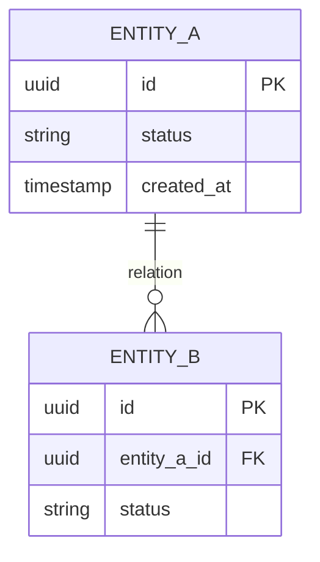

# {{Service Name}} - Spec

**Date:** YYYY-MM-DD | **Status:** Draft | In Review | Approved
**ADRs:** [ADR-001](../docs/adr/0001-xxx.md), [ADR-002](../docs/adr/0002-xxx.md)

## 1. What & Why

**What:** [1-2 sentences: what the system does.]
**Why:** [1 sentence: the problem it solves.]

## Out of scope

## 2. Acceptance Criteria

**Functional**
- [ ] **AC-1:** [Given / when / then, with status code or state]
- [ ] **AC-2:** [...]
- [ ] **AC-3:** [...]

**Non-functional**
- [ ] **NFR-1 (Reliability):** [retry count, backoff, what happens after the last failure]
- [ ] **NFR-2 (Performance):** [p95 latency at N rps, external call timeout]
- [ ] **NFR-3 (Security):** [auth method, secrets never in logs/responses]

**Verification:** each AC is checked by [test name / `make` target].

## 3. Architecture

| Module | Responsibility | Allowed deps | Why this boundary |
|--------|----------------|--------------|-------------------|
| `api` | [...] | `core`, `shared` | [1 short reason] |
| `core` | [...] | `shared` | [...] |
| `queue` | [...] | `core`, `shared` | [...] |
| `adapters` | [...] | `core` (ports), `shared` | [...] |
| `shared` | [...] | none | [...] |

**Interaction:** [1-2 sentences: who calls whom; dependencies point inward to `core`.]
**Forbidden:** [key rules, e.g. `api` never imports `adapters`; adapters never import each other.]
**Enforced by:** [linter rule / import-check script / `make check-deps`].

**API surface** (full payloads in `docs/api.md`)
| Endpoint | Purpose | Key codes |
|----------|---------|-----------|
| `METHOD /api/v1/...` | [...] | 2xx, 4xx, 503 |

## 4. Data & Relations

**Status transitions:** `A -> B -> C`; `B -> FAILED`. Forbidden: [e.g. `SENT -> *`].
**Key constraints:** [unique keys, FKs, partial indexes that the design depends on.]

## 5. Data Update Scenarios
<!-- 3 scenarios, 2-4 steps each. Name table.field and old → new value. -->
1. **Happy path:** [table.field: old → new, per step]
2. **Failure / retry:** [what changes, which counter increments, terminal state]
3. **Infra failure / edge case:** [behavior when queue/DB is down or worker crashes]

## 6. Risks & Decisions

| Risk | Impact | Mitigation | ADR |
|------|--------|------------|-----|
| [...] | High / Med / Low | [1 line] | [ADR-00X](...) |

## 7. Audit

Results: [`audit.md`](../audit.md). Every divergence is fixed by changing this spec, an AC, or a standard, not by a manual patch.
