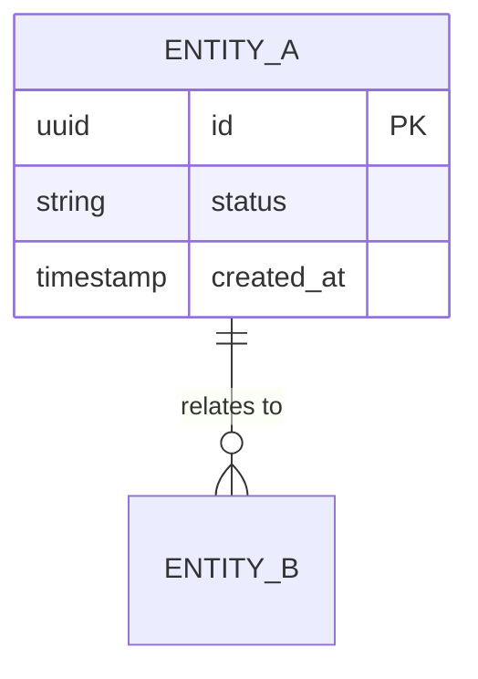

# {{Feature / Service Name}} - Technical Specification

**Date:** YYYY-MM-DD
**Status:** Draft | In Review | Approved
**Related ADRs:** [ADR-001](../docs/adr/adr-001.md)

---

## 1. Overview

### 1.1 Summary
[2-3 sentence description of what the system/feature does.]

### 1.2 Business Value
[What problem it solves and why it is needed.]

### 1.3 Target Users
[Who interacts with this system/feature and how.]

---

## 2. Requirements

### 2.1 Functional Requirements

#### FR-1: [Requirement Name]
- [ ] **Requirement:** [What the system must do]
- **Acceptance Criteria:**
  - [ ] [Measurable condition 1]
  - [ ] [Measurable condition 2]

### 2.2 Non-Functional Requirements
- [ ] **NFR-1 (Reliability):** [Retry policies, graceful error handling, idempotency]
- [ ] **NFR-2 (Performance):** [Expected API latency, external call timeouts]

### 2.3 Out of Scope
- [What this version explicitly does NOT include]

### 2.4 Risks & External Dependencies

| Risk | Impact | Mitigation |
|------|--------|------------|
| [Risk description] | High / Medium / Low | [How to mitigate] |

**External Dependencies:**
- [Service/Broker/API name] - [Role in the system]

---

## 3. Architecture & Module Boundaries

### 3.1 Component Overview
[Directory structure and high-level interaction between modules.]

| Module | Responsibility | Allowed Dependencies | Forbidden Dependencies |
|--------|----------------|----------------------|------------------------|
| `api` | HTTP endpoints, auth, payload validation | `core`, `shared` | `adapters`, `queue` internals |
| `core` | Domain models, business rules, state transitions | `shared` | `api`, concrete `adapters` |
| `queue` | Job producers and background workers | `core`, `adapters`, `shared` | `api` |
| `adapters` | External provider clients and DB repositories | `shared` | `api`, `queue`, sibling adapters |

### 3.2 API Contracts
- **Endpoint:** `METHOD /api/v1/...`
- **Headers:** `X-API-Key: <token>`
- **Request / Response:** [Payload structure and HTTP status codes]

### 3.3 Key Data Update Scenarios
1. **Happy Path:** [Step-by-step flow showing which records and statuses are created/updated in DB]
2. **Provider Failure & Retry:** [How status and attempt counters update on failure]
3. **Infrastructure Failure / Edge Case:** [Behavior when queue/DB is unavailable]

---

## 4. Database Schema (ER)

### 4.1 Entity-Relationship Diagram

### 4.2 State Lifecycle & Constraints
- **Allowed Status Transitions:** `STATE_A -> STATE_B -> STATE_C`
- **Indexes & Constraints:** [Unique keys, foreign keys, indexes on status/timestamps]
